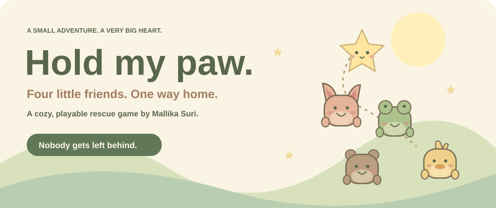
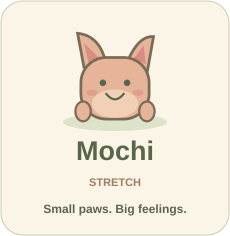
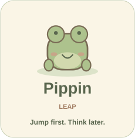
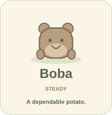
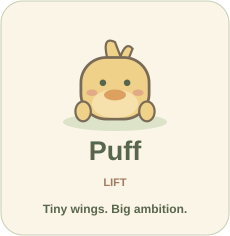
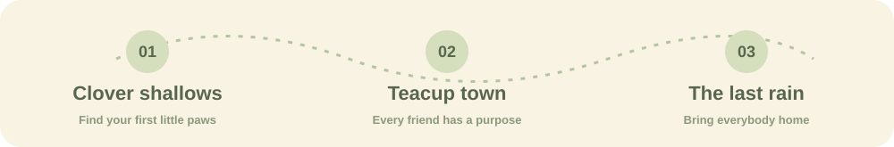

<p align="center">
  
</p>

<p align="center"><b>You’re a tiny star with a very big job.</b><br/>Find four stranded friends, hold their paws, and bring everyone home.</p>

<p align="center">
  <a href="#start-playing"></a>
  <a href="#pocket-guide"></a>
  <a href="#the-workshop"></a>
</p>

## Choose a little friend

*Tap a portrait to jump to their card. Open it to learn their trick.*

<p align="center">
  <a href="#mochi"></a>
  <a href="#pippin"></a>
  <a href="#boba"></a>
  <a href="#puff"></a>
</p>

<a id="mochi"></a>
<details>
<summary><b>🐾 Mochi’s card · “I was just… waiting for you.”</b></summary>

**Your stretchy little companion.** Mochi gives the chain more room to swing.

At the tangled trellis: choose Mochi’s portrait → move the **star** into the dotted circle → release Space → hold **E / Help**. The knot comes loose and the path stays open.

</details>

<a id="pippin"></a>
<details>
<summary><b>🐸 Pippin’s card · “We can jump over the WHOLE ocean.”</b></summary>

**Fast paws, questionable planning.** Pippin makes your group fly faster.

At the flower: let Pippin lead → star inside the circle → hold **E / Help** → release it and fly **right** through the petals. Don’t hug during the dash; it slows you down. Missed it? Try again.

</details>

<a id="boba"></a>
<details>
<summary><b>🍃 Boba’s card · “Is there a snack where we’re going?”</b></summary>

**A very dependable potato.** Boba makes strong winds gentler.

At the gust: put Boba first → steer against the wind to keep the star in the circle → hold **E / Help** until the wind settles.

</details>

<a id="puff"></a>
<details>
<summary><b>🐥 Puff’s card · “I can’t fly yet. But I can help.”</b></summary>

**Tiny wings. Enormous ambition.** Puff keeps the chain floaty.

At the high arch: let Puff lead → hold **E / Help** in the circle → fly **up and right** through the opening before it closes.

</details>

## Your tiny adventure



**Real movement. Wobbly physics. Little puzzles.** Your friends have different weights and abilities. Switch who leads, gather the chain in a hug, and help one another through.

<details>
<summary><b>✦ A note for first-time players &amp; judges</b></summary>

You don’t need to memorize anything. **An instruction popup appears when you reach each new mechanic.** The game and timers pause until you’re ready.

- Golden bells save your place.
- Fireflies are optional collectibles that improve your rating.
- A collision returns you safely to a checkpoint; friends stay with you.
- Timed gates and the boat have unlimited retries.
- The in-game **Play guide** pauses the adventure whenever you need a reminder.

</details>

## Start playing

**Runs in your browser. No account, backend, or API key needed.**

With **Node.js 22+** and **pnpm** installed:

```sh
git clone https://github.com/snowhiteohno/hold-my-paw.git
cd hold-my-paw
pnpm install
pnpm dev
```

Open **[localhost:4175](http://localhost:4175)** and take a little paw.

*The repository is currently private: cloning requires access. The localhost link works after starting the game on your computer.*

## Pocket guide

| What you want to do | Your little controls |
| :--- | :--- |
| Fly | **WASD / arrows**, or hold and move your mouse/finger |
| Pick the leader | **Q**, or click a rescued friend’s portrait |
| Use a friend’s skill | Hold **E / Help** inside their dotted circle |
| Gather everyone close | Hold **Space / Hold paws**; release to recharge |
| Take a breath | **Escape / P**, pause button, or Play guide |

<details>
<summary><b>⛵ Help! How do I catch the paper boat?</b></summary>

1. Fly the **star into the dotted oval above the boat**—not the water beneath it.
2. Stay close and hold **Space / Hold paws** for about a second.
3. Everyone boards together. If the timer ends, another boat appears.

On a touchscreen, steer with one finger and hold the action button with another.

</details>

<details>
<summary><b>🌙 Open only after the storm · ending spoiler</b></summary>

Your little star is tired. The friends you saved catch it.

**Now you guide them as they carry you.** Collect all three pink hearts, then fly to the cottage marked **HOME**. There is no timer here.

*You carried us. Our turn.*

</details>

<details>
<summary><b>⭐ Ratings, saves &amp; comfort settings</b></summary>

- **One star:** get everyone home.
- **Two stars:** collect at least 65% of the fireflies.
- **Three stars:** collect every firefly with at most two wobbles.

Chapter unlocks and best results save in your browser’s localStorage. If storage is blocked, you can still play; progress won’t survive a reload.

Music starts muted. Turn it on with the speaker button. **Gentler motion** is available in the pause menu and guide. Switching away from the browser pauses the game.

</details>

## The workshop

**React · TypeScript · Canvas 2D · Web Audio · CSS · Vite · pnpm**

Original canvas artwork, a custom Verlet friend-chain simulation, procedural sound, and self-hosted fonts. No external game engine.

<details>
<summary><b>🔧 Open the toolbox · build, test &amp; run</b></summary>

```sh
pnpm test            # game rules and progression
pnpm build           # TypeScript + production bundle
pnpm preview         # serve the built game on port 4175
```

Stop the dev server before starting preview; they use the same port.

With the game running:

```sh
pnpm exec playwright install chromium
pnpm test:browser    # desktop adventure + touch controls
pnpm test:guide      # guide access, pause/resume and layouts
```

The browser tests play through real inputs, including all four friend puzzles, boat retries, the ending, and contextual popups with frozen timers. They use isolated saves.

More detail: [development guide](docs/DEVELOPMENT.md).

</details>

<details>
<summary><b>🎨 Credits tucked inside</b></summary>

**Game by Mallika Suri.**

Typography: **DynaPuff** and **Nunito**, self-hosted through Fontsource under the SIL Open Font License. [DynaPuff license](public/fonts/dynapuff-OFL.txt) · [Nunito license](public/fonts/nunito-OFL.txt).

React, TypeScript, Vite, pnpm and Playwright retain their respective open-source licenses.

The README’s SVG illustrations are bundled in this repository. Portraits and menu tiles are links; expandable cards use GitHub’s native disclosure controls. This page is a guide to the game, not an embedded playable game.

</details>

<p align="center"></p>

<p align="center"><a href="#start-playing">Take the first little step ↑</a></p>
